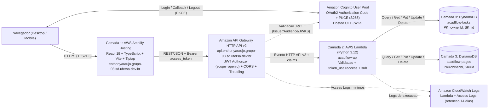

# AcadFlow

Workspace acadêmico web para organização de **tarefas**, **páginas** e **anotações estruturadas**, desenvolvido como projeto final individual da disciplina de **Sistemas Distribuídos — UFERSA**.

O projeto implementa uma arquitetura distribuída de **três camadas na AWS**, comunicação **REST/JSON baseada em recursos**, **dois domínios institucionais HTTPS**, autenticação via **Amazon Cognito (OAuth2 Authorization Code + PKCE)** e autorização com **isolamento estrito por usuário**.

---

## Demonstração Online (Produção HTTPS)

| Camada | Endereço Oficial | Finalidade |
|---|---|---|
| **Frontend (Camada 1)** | [https://enthonyaraujo.grupo-03.sd.ufersa.dev.br](https://enthonyaraujo.grupo-03.sd.ufersa.dev.br) | Aplicação SPA (React + TypeScript + Tiptap) hospedada no AWS Amplify Hosting com TLSv1.3 e SPA Rewrite. |
| **API REST (Camadas 2 e 3)** | [https://api.enthonyaraujo.grupo-03.sd.ufersa.dev.br](https://api.enthonyaraujo.grupo-03.sd.ufersa.dev.br) | API HTTP REST/JSON no Amazon API Gateway v2 integrada à AWS Lambda (Python 3.12) e ao Amazon DynamoDB. |

---

## Arquitetura do Sistema



- **Camada 1 (Apresentação):** SPA em React 19 + TypeScript + Vite + Tiptap hospedada no AWS Amplify Hosting com cabeçalhos HTTP de segurança (`HSTS`, `X-Content-Type-Options`, `X-Frame-Options`, `Referrer-Policy`, `Permissions-Policy` e `Content-Security-Policy-Report-Only`).
- **Camada 2 (Aplicação / Negócios):** Amazon API Gateway HTTP API v2 com JWT Authorizer (`scope=openid`), CORS restrito e throttling (`20 req/s`, burst `40`), roteando requisições para a função AWS Lambda `acadflow-api` (Python 3.12) responsável por validação, regras de negócio e controle de concorrência otimista.
- **Camada 3 (Persistência):** Amazon DynamoDB (`PAY_PER_REQUEST`, `DeletionProtectionEnabled=True`) com duas tabelas dedicadas (`acadflow-tasks` e `acadflow-pages`) particionadas por `ownerId` (`sub` autenticado) e ordenadas por `id`.

---

## Tecnologias Utilizadas

| Camada | Tecnologias e Versões Verificadas no Repositório |
|---|---|
| **Frontend** | React `19.3.1`, TypeScript `5.9.3`, Vite `6.4.6`, React Router `7.18.6`, Tiptap `3.35.0` (`StarterKit`, `TaskList`, `TaskItem`, `Placeholder`), `oidc-client-ts` `3.5.0` |
| **Backend** | Python `3.12`, AWS Lambda (`acadflow-api`, runtime `python3.12`), Amazon API Gateway HTTP API (v2) |
| **Banco de Dados** | Amazon DynamoDB (`acadflow-tasks` e `acadflow-pages`, chave composta `ownerId`/`id`, `PAY_PER_REQUEST`) |
| **Autenticação e Autorização** | Amazon Cognito User Pool (`acadflow-users`, cliente público sem secret, Authorization Code + PKCE S256) + JWT Authorizer |
| **Hospedagem e DNS** | AWS Amplify Hosting (`acadflow-web`), Amazon Route 53, AWS Certificate Manager (TLSv1.3) |
| **Testes e Qualidade** | Pytest `9.2.0` (backend Python 3.12), Vitest `4.1.12` (frontend), suíte HTTP E2E ([tests/e2e/smoke_api.py](tests/e2e/smoke_api.py)) e verificação de produção ([tests/e2e/verify_prod_domains.py](tests/e2e/verify_prod_domains.py)) |

---

## Funcionalidades Implementadas

- **Autenticação e sessão:** login e cadastro via Amazon Cognito Hosted UI (Authorization Code + PKCE), rotas protegidas no frontend, armazenamento de sessão em `sessionStorage`, revogação de *refresh token* e logout completo.
- **Dashboard acadêmico (`/`):** contadores reais de páginas e tarefas (pendentes, em andamento, concluídas), atalhos rápidos, páginas recentes e atividades em aberto.
- **Gerenciamento de tarefas (`/tasks`):** criação, listagem, edição, alteração de status (`pending`, `in_progress`, `done`), prioridades (`low`, `medium`, `high`), prazo opcional e exclusão com confirmação.
- **Gerenciamento de páginas e anotações (`/pages` e `/pages/:pageId`):** criação, listagem, renomeação, troca de ícone, edição estruturada e exclusão de páginas pessoais.
- **Editor rico Tiptap:** títulos (`H1`–`H3`), negrito, itálico, listas com marcadores, listas numeradas, checklists, citações e desfazer/refazer, persistidos como JSON ProseMirror validado no servidor.
- **Salvamento automático e controle de conflito:** debounce de 1,5 s com proteção contra envios simultâneos, alerta ao sair com alterações pendentes e concorrência otimista (`version` / `expectedVersion` -> `409 Conflict` com bloqueio do editor até recarga).
- **Interface responsiva e acessível:** design system tokenizado (contraste WCAG 2.2 AA verificado), sidebar recolhível no desktop, *drawer* responsivo até `360 px`, diálogos nativos `<dialog>` e code-splitting de rotas.
- **Isolamento por usuário:** cada conta acessa exclusivamente seus próprios registros (`ownerId = sub`), com retorno uniforme `404` para IDs inexistentes ou pertencentes a terceiros.

---

## Instalação e Execução Local

### Pré-requisitos
- **Git** (`>= 2.40`)
- **Python 3.12** (espelhando o runtime `python3.12` da AWS Lambda)
- **Node.js 20+ LTS** e **npm 10+**

### 1. Clonar o repositório
```bash
git clone https://github.com/enthonyaraujo/distributed_systems.git
cd distributed_systems
```

### 2. Configurar e testar o Backend (`services/api`)
```bash
python3.12 -m venv services/api/.venv
source services/api/.venv/bin/activate
pip install -r services/api/requirements-dev.txt
pytest services/api/tests -v
python services/api/build_package.py
```

Para executar a API localmente em memória (exclusivo para desenvolvimento; nunca implantado na AWS):
```bash
python services/api/local_server.py --host 127.0.0.1 --port 8000
```

### 3. Configurar, testar e executar o Frontend (`apps/web`)
Crie o arquivo local ignorado pelo Git a partir do template público:
```bash
cp apps/web/.env.example apps/web/.env.local
```

Preencha `apps/web/.env.local` apenas com variáveis **públicas** (`VITE_API_URL`, `VITE_COGNITO_*`, `VITE_APP_URL`). **Nunca** insira segredos, senhas ou credenciais AWS em arquivos `.env*`.

Instale dependências, valide e execute:
```bash
cd apps/web
npm ci
npm run test
npm run typecheck
npm run build
npm run dev
```

Acesse `http://localhost:5173`. *(No Windows PowerShell, ative o venv com `.\services\api\.venv\Scripts\Activate.ps1` e use `npm.cmd` se a `ExecutionPolicy` bloquear `npm.ps1`.)*

---

## Segurança e Privacidade

- **Autenticação e autorização em profundidade:** cliente público Cognito com Authorization Code + PKCE (`S256`), API Gateway JWT Authorizer (`scope=openid`) rejeitando chamadas anônimas (`401`) e ID tokens (`403`), e validação adicional na Lambda exigindo `sub` não vazio, `token_use == "access"` e `exp` vigente.
- **Isolamento de dados (anti-IDOR):** todas as operações no DynamoDB usam `Query` ou chave composta `(ownerId=sub, id)` com `ConditionExpression`, rejeitam `ownerId` enviado pelo cliente (`400`) e omitem `ownerId` das respostas JSON.
- **Proteção contra XSS e abuso:** validação server-side por allowlist estrita de nós, marcas, atributos e esquemas de URL (`http`, `https`, `mailto`) no JSON ProseMirror; cabeçalhos HTTP de segurança na API (`Cache-Control: no-store`, `X-Content-Type-Options: nosniff`, `X-Frame-Options: DENY`, `Referrer-Policy: no-referrer`) e no Amplify (incluindo `Content-Security-Policy-Report-Only`); throttling no stage `$default` (`20 req/s`, burst `40`).
- **Privacidade e logs mínimos:** DynamoDB armazena apenas `sub` opaco (sem e-mail/matrícula), `sessionStorage` sem rastreadores de terceiros, retenção de 14 dias nos logs da Lambda e Access Logs JSON mínimos no API Gateway (sem `Authorization`, tokens, cookies, e-mails ou corpos).
- **Validação real vs. escopo de auditoria:** os testes de integração em produção (**33/33 PASS** com duas contas reais do Cognito) comprovam o comportamento funcional de autenticação, autorização e isolamento, mas não substituem processos contínuos de revisão de segurança nem declaram o sistema invulnerável. Riscos residuais e limitações estão documentados em [docs/AUDITORIA_SEGURANCA.md](docs/AUDITORIA_SEGURANCA.md).

---

## Testes e Validação

Resultados verificados na última rodada completa (**23–25/11/2026**, Fedora Linux + produção AWS `us-east-1`):

| Suíte / Verificação | Escopo e Contexto | Resultado |
|---|---|---|
| **Backend unitário (`pytest`)** | `services/api/tests` em Python `3.12.14` (validação, allowlist Tiptap, headers, isolamento, DynamoDB) | **60/60 PASS** |
| **Frontend unitário (`vitest`)** | `apps/web` (`tasksApi`, `pagesApi`, `oidcConfig`, `validation`, `pageValidation`, `autosaveState`, `formatters`) + `typecheck` + `build` + `npm audit` | **19/19 PASS** · `0 vulnerabilities` |
| **API em produção (`smoke_api.py`)** | Testes HTTP reais contra `https://api.enthonyaraujo.grupo-03.sd.ufersa.dev.br` com **2 contas reais Cognito** (`401`, ID token `403`, `400`, CRUD, `409`, isolamento `404`, limpeza) | **33/33 PASS** |
| **Domínios institucionais (`verify_prod_domains.py`)** | Verificação somente leitura de TLSv1.3, 5 rotas SPA, bundle ao vivo (`jobId=4`, `/assets/index-B1UuEFK5.js`), `/health`, `401`, CORS e Hosted UI (com Learner Lab ativo) | **18/18 PASS** |
| **Validação visual em produção (`V-01` a `V-08`)** | Execução manual pelo autor no navegador Firefox em `https://enthonyaraujo.grupo-03.sd.ufersa.dev.br` (PKCE, CRUD + `F5`, Tiptap + auto-save, `409` em 2 abas, mobile `375 × 812`, sidebar, logout, DevTools e `CSP Report-Only`) | **8/8 aprovadas** |

---

## Estrutura do Repositório e Documentação

```text
/
├── apps/web/                         # Camada 1: React 19 + TypeScript + Vite + Tiptap
├── services/api/                     # Camada 2: AWS Lambda Python 3.12 + DynamoDB + Pytest
├── infra/                            # Scripts Python de diagnóstico/deploy/cutover + headers Amplify
├── tests/e2e/                        # Testes HTTP de aceitação (local e produção)
├── docs/                             # Documentação técnica, evidências e auditoria
├── AGENTS.md                         # Regras operacionais do repositório
└── README.md
```

### Documentos em `docs/`

| Documento | Conteúdo |
|---|---|
| [docs/AVALIACAO.md](docs/AVALIACAO.md) | Enunciado oficial da avaliação fornecido pelo docente *(somente leitura)*. |
| [docs/ARQUITETURA.md](docs/ARQUITETURA.md) | Arquitetura de 3 camadas, infraestrutura AWS publicada, contratos REST completos (`/health`, `/tasks`, `/pages`) e segurança. |
| [docs/IMPLANTACAO.md](docs/IMPLANTACAO.md) | Guia reproduzível de empacotamento, provisionamento, Amplify SPA Rewrite, cutover de DNS, manutenção e rollback. |
| [docs/AUDITORIA_SEGURANCA.md](docs/AUDITORIA_SEGURANCA.md) | Relatório sanitizado de auditoria (OWASP Top 10 / API Top 10 / AWS / LGPD), hardening aplicado e riscos residuais. |
| [docs/AUDITORIA_FRONTEND_UI_UX.md](docs/AUDITORIA_FRONTEND_UI_UX.md) | Auditoria profissional de Frontend, UI/UX, acessibilidade WCAG 2.2 AA e otimização de performance (Ondas 1–4). |
| [docs/EVIDENCIAS.md](docs/EVIDENCIAS.md) | Matriz final dos 20 critérios de aceitação, histórico de testes, roteiro de apresentação (6 min) e checklist SIGAA. |
| [docs/WORKSPACE_ACADFLOW.md](docs/WORKSPACE_ACADFLOW.md) | Especificação da evolução funcional P1 (Workspace, páginas e editor Tiptap). |
| [docs/PLANO_PROJETO_FINAL.md](docs/PLANO_PROJETO_FINAL.md) | Planejamento inicial e cronograma base do projeto. |

---

## Informações Acadêmicas

- **Instituição:** Universidade Federal Rural do Semi-Árido (**UFERSA**)
- **Disciplina:** Sistemas Distribuídos
- **Modalidade:** Projeto final individual
- **Apresentação e prazo de entrega:** 27/11/2026
